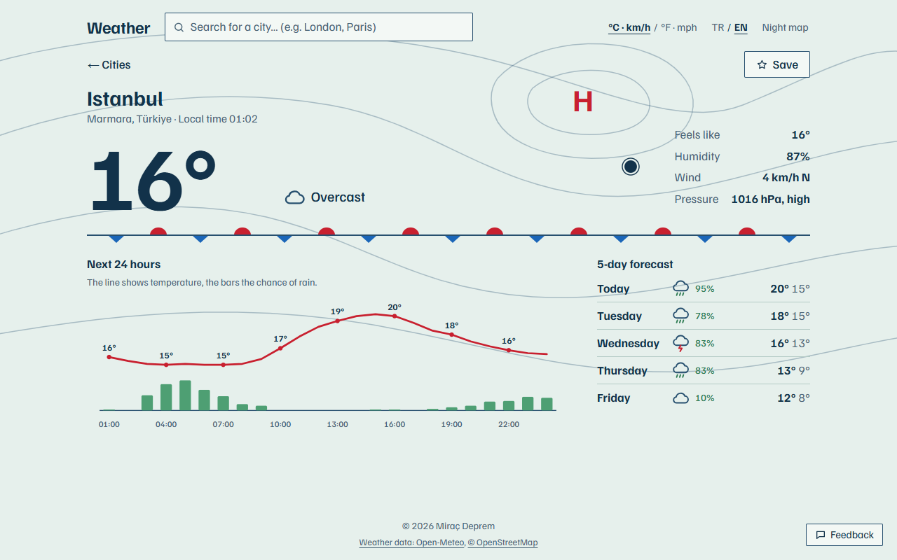
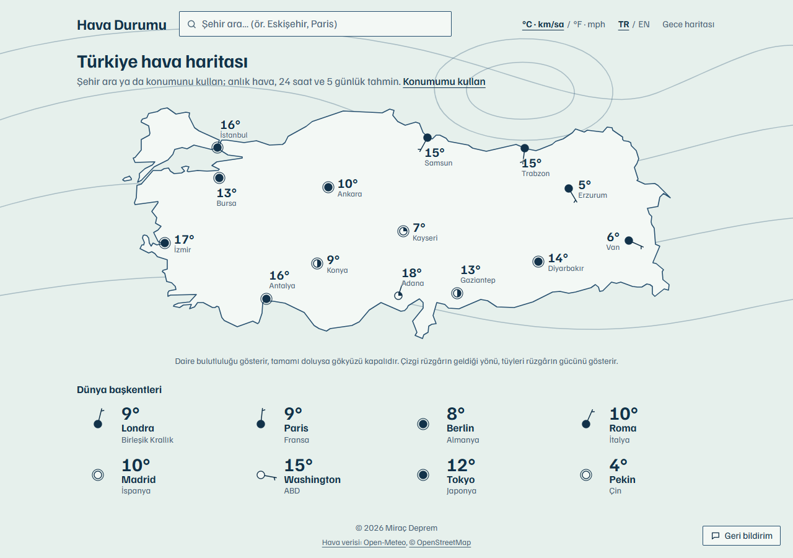
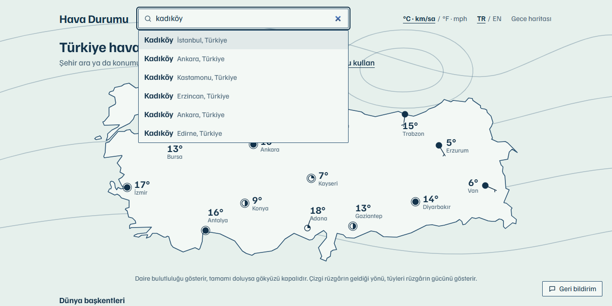
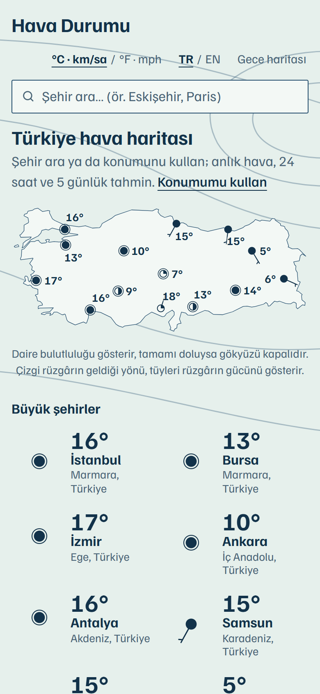

# Hava Durumu (Weather App)

[English](README.md) | **Türkçe**

Sade HTML, CSS ve JavaScript ile yazılmış bir hava durumu uygulaması. Bir şehir ya da ilçe arayarak veya konumunu kullanarak anlık havayı, 24 saatlik grafiği ve 5 günlük tahmini görebilirsin. API anahtarı ya da sunucu gerektirmiyor.

**Canlı demo:** [weather.miracdeprem.com](https://weather.miracdeprem.com)



## Özellikler

- **Ana sayfada hava haritası:** Türkiye'nin 14 ili haritada gerçek koordinatında, meteorologların haritalarındaki gibi istasyon işaretiyle duruyor: daire bulutluluğa göre doluyor, tüylü çizgi rüzgârın geldiği yönü ve gücünü gösteriyor. Ardından sekiz dünya başkenti geliyor: Londra, Paris, Berlin, Roma, Madrid, Washington, Tokyo ve Pekin. Hepsi tek istekte yükleniyor.
- **Türkçeyi anlayan arama:**
  - Sonuçlar iki açık kaynaktan aynı anda geliyor:
    - Türkiye'deki il, ilçe ve mahalleler için OpenStreetMap.
    - Dünya şehirleri için GeoNames.
  - "ısparta", "sanliurfa" ve "kadikoy" doğru yeri buluyor.
  - Yabancı şehirler "londra" ya da "moskova" gibi Türkçe adlarıyla aranabiliyor.
  - Hızlı cevap veren kaynağın sonuçları hemen görünüyor, diğeri gelince liste güncelleniyor.
  - Öneriler ↑/↓ ve Enter ile seçilebiliyor.
- **Konumumu kullan (isteğe bağlı):**
  - Bulunduğun yerin havasını gerçek yer adıyla gösteriyor, örneğin "Kadıköy · İstanbul, Türkiye".
  - İzin vermezsen kısa bir uyarı çıkıyor, arama çalışmaya devam ediyor.
  - Kaydetmedikçe konumun saklanmıyor. Kaydedilen konum yaklaşık 1 km'ye yuvarlanıyor ve tarayıcında kalıyor.
- **Şehir ayrıntısı:**
  - Anlık sıcaklık, hissedilen, nem ve rüzgâr.
  - Sıcaklık ve yağış olasılığını gösteren, kütüphanesiz SVG ile çizilmiş 24 saatlik grafik.
  - 5 günlük tahmin.
  - Şehrin yerel saati.
  - Gece için ay simgeleri.
- **Her şehrin kendi adresi:** Türkiye'nin 81 ili ve dünya başkentlerinin her birinin Türkçe ve İngilizce (`?lang=en`) kendi sayfası var. Örnek: [weather.miracdeprem.com/istanbul](https://weather.miracdeprem.com/istanbul).
- **Kayıtlı şehirler ve son aramalar:** Tarayıcında saklanıyor. Bulunduğun konumu da kaydedebilirsin.
- **Tek birim düğmesi:** °C ve km/sa ya da °F ve mph. Yeni istek atmadan bütün ekranları anında güncelliyor.
- **Türkçe ve İngilizce**, gündüz ve gece haritası.
- **Geri bildirim:** Küçük bir düğme; ad (isteğe bağlı), e-posta ya da telefon ve mesaj içeren formu açar. Mesaj portfolyo sitem üzerinden doğrudan bana ulaşır.
- **Erişilebilir:** Arama kutusu ekran okuyucular için doğru bir combobox, grafiğin metin özeti var ve telefonda da çalışıyor.

## Ekran Görüntüleri

| Ana sayfa: hava haritası | Türkçe arama | Telefonda |
|---|---|---|
|  |  |  |

## Kullanılan Teknolojiler

- HTML, CSS, JavaScript (ES modülleri, framework yok, derleme adımı yok)
- [Open-Meteo](https://open-meteo.com): tahminler ve dünya şehirleri araması (GeoNames)
- komoot'un [Photon](https://photon.komoot.io) servisi: Türkiye içi arama (OpenStreetMap)
- [BigDataCloud](https://www.bigdatacloud.com/free-api/free-reverse-geocode-to-city-api): konumun adı
- `node --test`: 75 birim testi
- Sıkı bir Content Security Policy ile Vercel
- **API anahtarı ve npm bağımlılığı yok**

## Kurulum ve Çalıştırma

[weather.miracdeprem.com](https://weather.miracdeprem.com) adresini aç ya da kendi bilgisayarında çalıştır (Node.js 20 veya üstü):

```bash
git clone https://github.com/MrcDprm/weather-app.git
cd weather-app
npm run dev
```

Sonra `http://localhost:5174` adresini aç. Küçük geliştirme sunucusu canlı sitedeki güvenlik başlıklarının aynısını gönderiyor. Böylece CSP'nin engelleyeceği bir şey yerelde de fark ediliyor.

Testleri çalıştırmak için:

```bash
npm test
```

### Proje yapısı

```
app.html, styles.css      Sayfa şablonu ve stiller
api/page.js               Her adresi (/, /istanbul, /londra …) kendi başlığı, açıklaması ve yapılandırılmış verisiyle sunar
lib/                      Sayfa fonksiyonu için <head> üreticisi ve sitemap
src/routes.js             Adresler: 81 il ve 8 dünya başkenti
src/provinces.js          Türkiye'nin 81 ilinin koordinatı ve bölgesi
src/weather.js            Tahmin yanıtlarını sade nesnelere çevirir; hava kodları, birim dönüşümü
src/places.js             Dünya başkentleri, iki kaynaktan gelen arama sonuçları, birleştirme ve sıralama
src/map.js                Türkiye sınırı, haritadaki istasyonlar ve konumları
src/station.js            İstasyon işareti kuralları: bulutluluk, rüzgâr tüyleri, yön, basınç merkezi
src/storage.js            Ayarlar, kayıtlı şehirler ve son aramalar; her okumada doğrulanır
src/api.js                Open-Meteo, Photon ve BigDataCloud istekleri (zaman aşımıyla)
src/chart.js              24 saatlik SVG grafik
src/icons.js              SVG çizgileriyle çizilmiş hava simgeleri
src/main.js               Ekranlar, arama, konum, dil, birim ve tema
scripts/dev-server.mjs    vercel.json'daki başlıkları ve yönlendirmeleri uygulayan yerel sunucu
tests/                    Birim testleri
```

### Gizlilik

- Kendi sunucum yok. Tarayıcın hava durumu ve arama servisleriyle doğrudan konuşuyor.
- Konumunu kullandığında koordinatlar (yaklaşık 10 metreye yuvarlanarak) tahmin için Open-Meteo'ya, yer adı için BigDataCloud'a gönderiliyor. Sen kaydetmedikçe saklanmıyor; kaydedersen yaklaşık 1 km'ye yuvarlanıp tarayıcında kalıyor.
- Ayarlar, kayıtlı şehirler ve son aramalar tarayıcının yerel deposunda kalıyor.

## Öğrendiklerim

- **Dışarıdan gelen veriye asla güvenmemek.** Her yanıt ekrana gelmeden önce kontrol ediliyor. Eksik bir sayı "—" oluyor, bozuk satır atlanıyor, bilinmeyen alanlar atılıyor. Yerel depodan geri okuduklarım da aynı kontrolden geçiyor, çünkü orası elle değiştirilebiliyor.
- **İki kusurlu kaynağı birleştirmek.** Yer veritabanlarından biri İstanbul'daki Kadıköy'ü aynı adlı daha küçük yerlerin arkasında listeliyor. Diğeri ise Türkçe yazılan "Londra"yı bulamıyor. İkisini birlikte sorguluyorum. Türkçe harfleri sadeleştirerek "sanliurfa"yı "Şanlıurfa" ile eşleştiriyorum, bulanık eşleşmeleri eliyorum, başkentleri öne alıyorum ve aynı yeri ad ile mesafeye bakarak tekrar göstermiyorum.
- **Yavaş cevabın kazanmasına izin vermemek.** Arama son tuşa basıldıktan 300 ms sonra başlıyor. Her isteğin bir numarası var; geç gelen eski bir cevap yenisinin üstüne yazılamıyor. Hızlı kaynağın sonuçları yavaş olanı beklemeden gösteriliyor.
- **Meteoroloji işaretlerini koda dökmek.** Rüzgâr tüylerinin kuralını öğrendim: yarım tüy 5, tam tüy 10, bayrak 50 knot. Bu hesabı ve bulutluluk dolgusunu ekrandan ayrı bir modüle koyduğum için test edebildim.
- **Süs ile veriyi ayırmak.** Arka plandaki basınç çizgileri süs, bu yüzden üzerlerine sayı koymadım; A/Y harfi ise yalnızca şehrin gerçek basıncından geliyor.
- **Grafiği elle çizmek.** Grafik birkaç SVG çizgisi ve dikdörtgenden oluşuyor. Hesabı ayrı bir fonksiyona koyduğum için test edebildim: en sıcak saat en üstte, sıcaklıklar eşitse sıfıra bölme olmuyor, yağış verisi yoksa çubuk çizilmiyor.
- **Saat dilimleri.** Tahmin saatleri şehrin yerel saatiyle geliyor. "2026-10-01" gibi bir tarih gece yarısı olarak okunursa bir önceki güne kayabiliyor. Öğlen UTC olarak okumak gün adını doğru tutuyor.
- **Statik bir site için güvenlik başlıkları.** CSP sadece kullandığım servislere bağlantıya izin veriyor, konum izni de sadece bu siteye açık. Yerel geliştirme sunucusu da aynı başlıkları gönderiyor; engellenen bir istek canlı siteye çıkmadan fark ediliyor.

## Kaynaklar

- Hava verisi ve dünya şehirleri araması: [Open-Meteo](https://open-meteo.com) (CC BY 4.0); Open-Meteo [GeoNames](https://www.geonames.org) (CC BY 4.0) verisini kullanıyor.
- Türkiye içi arama: komoot'un [Photon](https://photon.komoot.io) servisi; veriler © [OpenStreetMap katkıcıları](https://www.openstreetmap.org/copyright) (ODbL).
- Konum adları: [BigDataCloud](https://www.bigdatacloud.com) ücretsiz ters coğrafi kodlama.

## Lisans

[MIT](LICENSE)
